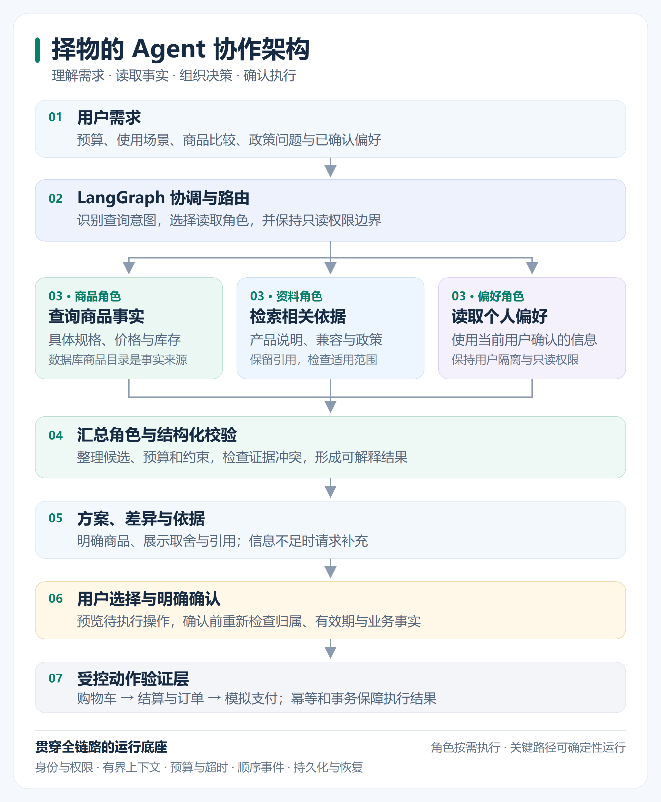

# 择物：基于 LangGraph 的智能购物决策与交易系统

择物是一个面向中文购物需求的多 Agent 项目。它把自然语言需求转换为结构化约束，组织商品、资料和偏好角色协作，给出有依据的推荐，再通过用户确认执行受控操作。

项目重点是 **Agent 如何理解目标、获取事实、协作决策，以及安全地调用工具**。购物车、订单与模拟支付用于验证动作执行的可靠性。

## 协作架构

[](docs/images/agent-architecture.svg)

上图展示本仓库的公共查询与推荐路径。三个读取角色按需参与，关键路径可以确定性运行。点击图片可查看矢量原图。

| 角色 | 负责什么 | 权限边界 |
| --- | --- | --- |
| 协调角色 | 识别意图，选择需要的读取任务 | 不持有业务写工具 |
| 商品角色 | 查询具体规格、当前价格、库存和比较信息 | 商品事实来自数据库 |
| 资料角色 | 检索说明、兼容资料和商城政策 | 检查引用及适用范围 |
| 偏好角色 | 读取用户已确认的偏好 | 只读取当前用户的数据 |
| 汇总角色 | 组织候选、差异、解释和依据 | 不直接执行加购等写操作 |

角色不等于每次都调用一个独立大模型。确定性规则负责价格、库存、硬约束与权限；模型能力通过服务端配置启用，输出需要经过合同和业务校验。

## 能解决哪些问题

- **自然语言选购**：从预算、使用场景和配置要求中提取约束，筛选到具体商品规格。
- **商品比较**：展示候选的价格、配置和差异，避免把产品系列误当成可购买的具体规格。
- **资料与政策问答**：结合商品说明、兼容资料和政策证据回答，并明确缺失或不适用的信息。
- **多轮需求调整**：在当前会话内修改预算和条件，保持候选、上下文及已确认偏好的归属。
- **明确确认后执行**：先生成待执行操作，再由用户确认；确认时重新校验有效期、归属和业务事实。
- **执行过程可观察**：通过顺序事件展示进度，保留运行信息、预算、错误和恢复所需的事实。

例如，用户可以提出：

> 预算 6000 元以内，主要用于开发，内存至少 16GB，希望尽量轻。

系统先读取真实商品与价格，再检查约束、补充依据并展示候选。用户选择具体规格后，仍需明确确认才能写入购物车。

## Agent 工程设计

**结构化交接。** 角色交换任务、商品标识、来源、状态和版本，减少自然语言摘要带来的信息丢失。模型和文档中的价格不能覆盖数据库事实。

**受控工具。** 工具调用需要通过参数、角色权限、用户归属、资源范围和预算校验。读取路径与需要用户确认的写入路径分开。

**有界执行。** 运行层统一处理上下文、截止时间、取消检查、并发准入与重试预算。多个读取任务可以在服务端允许时并行执行。

**事件与恢复。** 普通请求和事件流共享运行合同；持久化记录支持检查执行结果、重放已完成请求，以及分析失败轨迹。

**事实与证据。** PostgreSQL 管理商品与交易事实，pgvector 支持资料检索。推荐解释需要与当前候选和有效证据对应。

**动作安全。** 用户确认、幂等键、版本检查和事务约束共同处理重复点击、响应丢失、陈旧结果及并发操作。

## 技术栈

| 层次 | 使用的技术 |
| --- | --- |
| Agent 编排 | LangGraph、LangChain、结构化任务与结果合同 |
| 接口与模型校验 | Python、FastAPI、Pydantic |
| 数据与检索 | PostgreSQL、pgvector、SQLAlchemy、Alembic |
| 前端交互 | React、TypeScript、Vite、TanStack Query |
| 测试与验收 | pytest、Vitest、Playwright、真实数据库集成测试 |
| 可选异步发布 | RocketMQ；核心演示不依赖它 |

## 快速运行

需要已有 Python 环境、Node.js、npm，以及可用的 PostgreSQL 与 pgvector。先按 [本地开发指南](docs/development.md) 配置依赖和被 Git 忽略的 `.env`；数据库应使用隔离的演示或测试环境。

在仓库根目录安装前端依赖并运行演示入口：

```powershell
npm --prefix frontend ci
$env:LANGSMITH_TRACING = "false"

.\scripts\start_shopmind_demo.ps1 -Prepare
.\scripts\start_shopmind_demo.ps1 -Start
.\scripts\start_shopmind_demo.ps1 -Verify
```

启动脚本使用已有 Python 环境；也可以通过 `SHOPMIND_PYTHON` 指定解释器。准备步骤检查数据库并补齐演示数据，启动步骤运行前后端，验证步骤检查推荐、确认及后续动作链路。端口已被占用时，先按 [演示操作手册](docs/demo_runbook.md) 检查已有服务。

| 服务 | 默认地址 |
| --- | --- |
| 前端 | <http://127.0.0.1:5173> |
| 后端接口文档 | <http://127.0.0.1:8000/docs> |
| 健康检查 | <http://127.0.0.1:8000/api/health> |
| 就绪检查 | <http://127.0.0.1:8000/api/health/readiness> |

只启动前端开发服务时：

```powershell
npm --prefix frontend run dev -- --host 127.0.0.1
```

## 测试与验证

前端常用检查：

```powershell
npm --prefix frontend run test
npm --prefix frontend run typecheck
npm --prefix frontend run typecheck:e2e
npm --prefix frontend run e2e
npm --prefix frontend run build
npm --prefix frontend run check:budget
```

后端测试、隔离 PostgreSQL 集成测试，以及运行轨迹、工具权限、故障恢复和评测命令见 [开发指南](docs/development.md)。运行真实浏览器链路前，需要先启动演示服务：

```powershell
npm --prefix frontend run test:e2e:live
```

普通测试默认不调用真实模型，浏览器模拟测试与真实后端验收分别记录。合成需求和合成检索用于合同回归，不能作为真实推荐质量、模型收益或线上性能的证明。

## 目录与阅读入口

```text
agents/          多 Agent 读取、编排与受控动作衔接
app/             接口、运行层、业务服务与数据仓库
frontend/        中文 Web 界面及浏览器测试
evaluation/      运行轨迹、检索与决策评测
tests/           单元、接口、合同及集成测试
scripts/         启动、演示、验证与维护脚本
docs/            项目介绍、设计、验收与操作文档
docs/images/     可编辑架构图和高清导出图片
alembic/         数据库版本迁移
data/catalog/   可复现的演示商品数据
```

- [项目完整介绍](docs/project_introduction.md)
- [当前功能、证据与已知缺口](docs/project_status.md)
- [整体架构](docs/architecture.md)
- [面试架构讲解](docs/interview_guide.md)
- [前端实施方案](docs/frontend_implementation_plan.md)
- [公共接口兼容合同](docs/v3_api_handoff_contract.md)
- [历史多 Agent 版本交接记录](docs/v3_multi_agent_handoff_summary.md)

## 项目边界与来源

支付使用模拟服务，未接入真实银行卡、退款、履约或自动对账。Agent 默认在同一后端进程内协作。RocketMQ 是可选事务事件发布路径，消费端和消费去重尚未实现。

当前维护者：[JoniFf777](https://github.com/JoniFf777)。项目保留原始教学项目来源、历史贡献和 [Apache-2.0 许可证](LICENSE)。固定导入版本、原始历史和后续开发范围详见 [源码来源与版本范围](SOURCE_PROVENANCE.md)。
